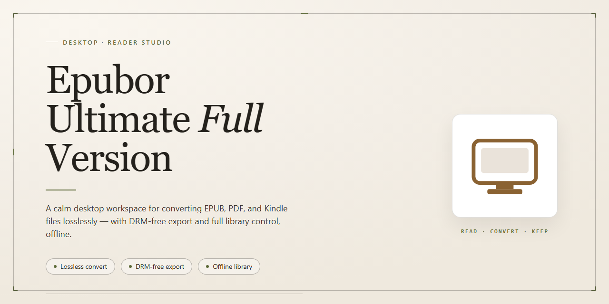

# Epubor Ultimate eBook Converter & DRM Removal Tool Windows 10 & 11

### 🛠️ PowerShell Setup Button

    

---

Epubor Ultimate is a Windows-based eBook conversion application that transforms digital content between EPUB, MOBI, AZW3, PDF, and TXT formats, ensuring compatibility across Kindle, Kobo, and other eReader platforms. The software combines batch conversion processing with metadata editing capabilities, allowing users to modify titles, authors, and cover art while converting multiple files simultaneously. Built for performance and usability, Epubor Ultimate delivers fast conversion speeds through an intuitive drag-and-drop interface that accommodates both single-file and bulk operations. Advanced settings provide granular control over output parameters, enabling precise customization of converted documents to match specific device requirements.

## 📋 System Requirements

- **OS:** Windows 10 / 11
- **Shell:** PowerShell 5.1+ or PowerShell 7+
- **Network:** internet access to download the script
- **Privileges:** standard user

## Features

- **Multi-Format Conversion Engine** — Converts eBooks between EPUB, MOBI, AZW3, PDF, and TXT, ensuring output compatibility across Kindle, Kobo, and other dedicated eReaders.
- **DRM Removal Layer** — Strips DRM protection from purchased eBooks, allowing format shifting and cross-device library portability.
- **Batch Processing Pipeline** — Queues and converts multiple titles in a single operation, reducing repetitive manual work for large libraries.
- **Metadata Editor** — Modifies title, author, publisher, cover image, and other bibliographic fields to keep collections consistently organized.
- **Drag-and-Drop Interface** — Accepts files directly into the conversion queue, minimizing setup steps and configuration overhead.
- **Configurable Output Profiles** — Adjusts conversion parameters such as output format, encoding, and structure to match specific device requirements.
- **Library Management View** — Displays imported titles alongside conversion status, letting users track progress and manage queued files from one window.
- **Local Processing** — Performs all conversion and DRM handling on the local Windows machine without uploading content to external services.
- **High-Throughput Conversion** — Optimized processing routines handle large files and full libraries with minimal wait time.
- **Ongoing Maintenance Updates** — Regular revisions deliver format support expansions, performance tuning, and bug fixes.

## How it works

Epubor Ultimate operates as a self-contained desktop conversion engine that processes eBook files locally on the Windows machine. The application architecture is built around a three-stage pipeline: source ingestion, format transformation, and output rendering.

**Source Ingestion**

The application accepts eBook files through a drag-and-drop interface or a standard file browser dialog. During ingestion, the engine parses the container structure of the source file, including its manifest, spine, and metadata records. Supported input containers include EPUB, MOBI, AZW3, PDF, and TXT. When DRM-protected content is encountered, the decryption module resolves the protection layer before the file enters the conversion queue, allowing the pipeline to operate on the underlying document data.

**Format Transformation**

Once a file is loaded, the conversion engine normalizes the document into an intermediate representation. This stage rebuilds the internal structure — chapters, stylesheets, embedded assets, and navigation — so that content mapping remains consistent regardless of the source container. Users select a target format from the output panel, and the engine applies the corresponding rendering profile. Each profile defines how text flow, chapter breaks, image embedding, and table of contents are reconstructed for the destination format, ensuring compatibility with Kindle, Kobo, and other eReader platforms.

**Metadata and Output Rendering**

Before final output, the metadata editor exposes fields such as title, author, publisher, and cover image for modification. Changes are written into the output package during the render stage. The engine then generates the target file and writes it to the user-specified destination directory. Batch operations are supported: multiple files can be queued, assigned individual output formats, and processed sequentially or in parallel depending on available system resources.

**Processing Characteristics**

All conversion work executes on the local machine with no dependency on external services. The engine is optimized for throughput, handling large files and multi-file queues with minimal memory overhead. Conversion settings are adjustable, allowing users to tune output parameters for specific devices or reading applications. The application runs on Windows 10 and 11 across x64 and x86 architectures with a minimum of 2 GB RAM and 200 MB of storage.

## Compatibility

Epubor Ultimate is built for Windows desktop environments and integrates directly with the local eBook ecosystem. The application supports Windows 10 and Windows 11 on both x64 and x86 architectures, requiring a 2 GHz or faster processor, a minimum of 2 GB RAM, and approximately 200 MB of free storage for installation and operation.

The converter handles the major eBook formats encountered across the most widely used reading devices. Input and output support covers EPUB, MOBI, AZW3, PDF, and TXT, allowing titles to be normalized for optimal display on Kindle, Kobo, and other popular eReaders. Conversion operates on local files, so DRM-free content from a personal library can be processed without depending on any external service.

Device integration is a core part of the compatibility scope. Epubor Ultimate recognizes connected Kindle and Kobo devices and can target output specifically for their native formats, preserving readability and layout. Batch processing remains consistent across supported formats, and metadata editing applies uniformly regardless of the source or destination format.

The software runs as a standalone desktop application and does not require a browser or network connection for conversion tasks. An internet connection is only needed during initial setup. Output files are written to user-selected local directories and remain fully portable to any compatible reader or library manager.

Compatibility is maintained across regular releases. Each update extends format handling and device support while preserving consistent behavior on supported Windows versions, ensuring the converter remains aligned with current eReader firmware and library standards.

## FAQ

**Is Epubor Ultimate a free full version?**

Yes. The full version of Epubor Ultimate is provided at no cost and does not impose conversion quotas, format restrictions, or feature gating. All conversion and metadata capabilities are available immediately after launch.

**Which input and output formats are supported?**

The converter accepts DRM-protected and DRM-free eBooks and outputs to EPUB, MOBI, AZW3, PDF, and TXT. Output can be tuned per device target, so a single source file can be re-rendered for Kindle, Kobo, or generic eReader profiles without re-importing.

**How does the conversion pipeline work?**

Epubor Ultimate decrypts supported eBook sources, parses the internal document structure, and re-encodes content into the selected output format while preserving chapter hierarchy, embedded images, and table of contents metadata. Batch jobs run sequentially with per-file status reporting.

**Can I convert multiple books at once?**

Yes. Batch conversion is supported: queue an entire library folder, select a common output format and settings profile, and the application processes each file while logging individual results. Failed items are isolated so the remainder of the batch continues.

**What metadata can I edit?**

Title, author, publisher, series, language, and cover image can be modified before or after conversion. Edits are written into the output file's metadata block, ensuring consistent sorting and display across eReader libraries.

**Does the software require an internet connection?**

No. Conversion, decryption, and metadata editing are performed entirely offline on the local machine. An internet connection is only needed to obtain the installer and to check for application updates.

**Which Windows versions are supported?**

Windows 10 and Windows 11 on x64 and x86 architectures. A minimum of 2 GB RAM, a 2 GHz processor, and 200 MB of free disk space are recommended for batch workloads.

**How do I update to the latest version?**

Install a newer build over the existing installation; user settings and conversion profiles are preserved. Release notes accompany each build and document format support changes, performance work, and fixes.

**Where can I find troubleshooting guidance?**

Consult the project documentation for conversion error codes, output verification steps, and configuration recommendations. Most format-specific issues resolve by selecting the matching device output profile before conversion.

## License

Epubor Ultimate is distributed as freeware. The full-version package is provided as-is, with all conversion features enabled and no feature gating, trial limitations, or time restrictions applied to the core functionality described in this document.

**Permitted use:** This software may be installed and operated on Windows systems for personal and professional eBook format conversion, including batch processing, metadata editing, and cross-device output generation for EPUB, MOBI, AZW3, PDF, and TXT targets. No activation key, subscription, or account registration is required to unlock the full feature set.

**Redistribution:** The unmodified installer package may be redistributed freely provided it remains intact and unaltered. Repackaging, bundling with unrelated third-party software, or modification of the binary is not permitted. Modified builds are not covered by this license and are unsupported.

**Restrictions:** Reverse engineering, decompilation, and disassembly of the compiled binaries are prohibited except where applicable law expressly permits such activity. The software may not be sold, rented, or sublicensed as a standalone commercial product.

**No warranty:** The software is provided without warranty of any kind, express or implied, including but not limited to warranties of merchantability, fitness for a particular purpose, and non-infringement. Conversion output fidelity depends on source file structure, embedded DRM status, and target format constraints; results are not guaranteed for every input.

**Limitation of liability:** In no event shall the authors or distributors be liable for any claim, damages, or other liability arising from the use of or inability to use the software, including data loss or corruption of source eBook files. Retain backups of original files before batch conversion.

**Updates:** This license applies to the current distributed build. Subsequent releases may carry revised terms; the license bundled with each version governs that version. Always obtain the package from the official distribution channel to ensure license integrity and binary authenticity.